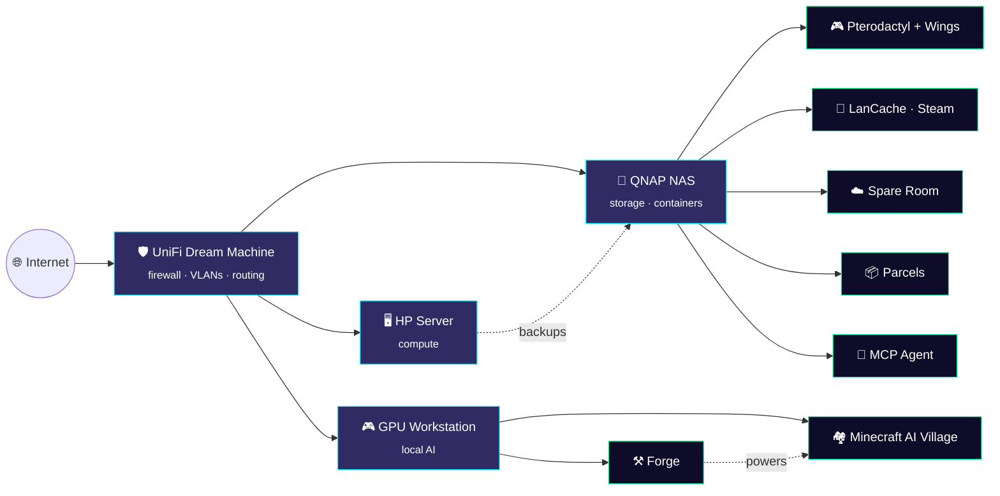

<!-- ═══════════════════════ HEADER ═══════════════════════ -->
<p align="center">
  
</p>

<p align="center">
  <a href="https://github.com/YOUR_USERNAME">
    
  </a>
</p>

<p align="center">
  
  
  
  
</p>

<p align="center">
  
</p>

<!-- ═══════════════════════ TERMINAL ═══════════════════════ -->

## `> cat about_me.json`

```json
{
  "handle":       "Wiggly",
  "role":         "Senior IT Engineer & Developer",
  "location":     "United Kingdom 🇬🇧",
  "responsibilities": [
    "Owning 1st & 2nd line escalations",
    "Windows Server, licensing & activation",
    "Networking, firewalls & infrastructure",
    "Training & mentoring a 1st Line IT Support Engineer 🎓"
  ],
  "currently_building": ["Forge (local AI)", "Minecraft AI Village"],
  "side_quests":  ["Fixing code for projects I love", "Patching broken Minecraft mods 🧩"],
  "open_to":      "lending a helping hand — just ask",
  "homelab":      "always growing, never finished",
  "coffee_level": "critical ☕",
  "fun_fact":     "my NAS has more uptime than I do"
}
```

<!-- ═══════════════════════ PROJECTS ═══════════════════════ -->

## `> ls ./projects`

<table>
<tr>
<td width="50%" valign="top">

### ⚒️ Forge


My own **local AI desktop app** for Windows. Loads open-weight models, fine-tunes them on my own data, runs entirely on my GPU. Zero subscriptions, zero cloud.

<sub>`Python` · `PyTorch` · `CUDA` · `Fine-tuning` · `Desktop UI`</sub>

</td>
<td width="50%" valign="top">

### 🏘️ Minecraft AI Village


**10 autonomous AI players** living, building and arguing on a Java server. Controllable through MCP, with a neon **brain dashboard** to watch their thoughts overnight.

<sub>`Minecraft Java` · `MCP` · `Node.js` · `LLMs` · `Agents`</sub>

</td>
</tr>
<tr>
<td width="50%" valign="top">

### ☁️ Spare Room


A **private cloud storage service** I run myself on a QNAP NAS, offering storage plans to friends and family.

<sub>`QNAP` · `Storage` · `Self-hosted` · `Access control`</sub>

</td>
<td width="50%" valign="top">

### 📦 Parcels


A self-hosted **parcel & proof-of-delivery tracker** for my eBay selling, containerised on the NAS.

<sub>`Docker` · `Container Station` · `Web app`</sub>

</td>
</tr>
</table>

<!-- ═══════════════════════ HELPING HAND ═══════════════════════ -->

## `> git commit -m "fixed it for you"`

<table>
<tr>
<td width="60%" valign="top">

### 🧩 Mod Fixer & Code Medic

If I like your project, there's a good chance I'll end up **fixing something in it**. I love jumping into codebases, tracking down bugs, and sending PRs.

My favourite thing of all? **Fixing Minecraft mods.** Crashes on launch, broken after a version update, conflicts with another mod — bring it to me. 🔧

- 🐛 Bug hunting & crash-log detective work
- 🔄 Porting & updating mods to newer versions
- 🤝 Friendly PRs, no gatekeeping
- 💬 Stuck on something? **Open an issue or reach out — happy to help**

</td>
<td width="40%" align="center" valign="middle">

<br><br>
<br><br>


</td>
</tr>
</table>

<!-- ═══════════════════════ HOMELAB ═══════════════════════ -->

## `> tree ./homelab`



<!-- ═══════════════════════ TECH ═══════════════════════ -->

## `> echo $STACK`

<p align="center">
  
</p>

<p align="center">
  
  
  
  
  
  
  
  
</p>

<!-- ═══════════════════════ STATS ═══════════════════════ -->

## `> top --user wiggly`

<p align="center">
  
  
</p>

<p align="center">
  
</p>

<p align="center">
  
</p>

<p align="center">
  
</p>

<!-- ═══════════════════════ SNAKE ═══════════════════════ -->

<p align="center">
  <picture>
    <source media="(prefers-color-scheme: dark)" srcset="https://raw.githubusercontent.com/YOUR_USERNAME/YOUR_USERNAME/output/snake-dark.svg" />
    <source media="(prefers-color-scheme: light)" srcset="https://raw.githubusercontent.com/YOUR_USERNAME/YOUR_USERNAME/output/snake.svg" />
    
  </picture>
</p>

<!-- ═══════════════════════ EXTRAS ═══════════════════════ -->

<details>
<summary><b>🎓 &nbsp;Currently mentoring</b></summary>
<br>

Training up a **1st Line IT Support Engineer** — triage, ticket hygiene, AD & M365 basics, remote support, and the most important skill of all: *"have you tried turning it off and on again?"* (and knowing when that's **not** the answer).

</details>

<details>
<summary><b>⚡ &nbsp;Fun facts</b></summary>
<br>

- 🐳 Self-hosts a Steam cache because waiting for downloads is for other people
- 🤖 Has 10 AI villagers who probably gossip about him
- 🧩 Will fix your Minecraft mod before you've finished describing the crash
- 💾 Treats "the NAS" as a member of the household
- 🔥 Breaks things on purpose at home so they don't break at work

</details>

<details>
<summary><b>🕹️ &nbsp;Secret</b></summary>
<br>

```
↑ ↑ ↓ ↓ ← → ← → B A
```
You found it. Achievement unlocked: **Curious Engineer** 🏆

</details>

<br>

<p align="center">
  
</p>

<!-- ═══════════════════════ FOOTER ═══════════════════════ -->
<p align="center">
  
</p>
